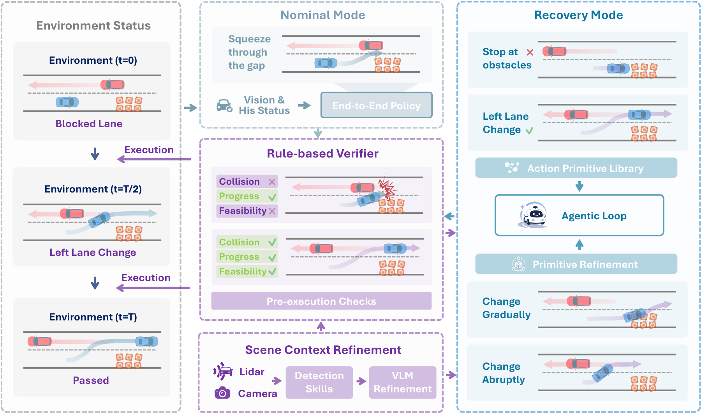

# AutoAgent0: An Agentic Runtime for Safe Closed-Loop Driving

Jiageng Liu, Seth Z. Zhao, Zewei Zhou, Alejandro Huerta, Aidan Bayer-Calvert, Yuxin Bao, Haotian Lin, Robert Spataru, Zijun Cui, Yining Hong, Bolei Zhou, Jiaqi Ma

UCLA · Carnegie Mellon University · UT Dallas · Stanford University

[Paper](https://arxiv.org/abs/2610.18866) | [Project Page](https://jiagengliu02.github.io/AutoAgent0/) | [Quick Start](docs/quickstart.md)

[](https://jiagengliu02.github.io/AutoAgent0/assets/videos/overview.mp4?v=film-v02-slide8-fixed)

[? Watch the overview video (2:50)](https://jiagengliu02.github.io/AutoAgent0/assets/videos/overview.mp4?v=film-v02-slide8-fixed)

## Introduction

**AutoAgent0** is an agentic runtime for safe closed-loop driving. It augments frozen driving experts with independent scene assessment, trajectory verification, and feedback-driven recovery.

- **Scene context refinement** combines complementary perception skills to identify safety-critical actors and refine the context used for verification.
- **Rule-based verification** checks nominal and recovery trajectories before execution.
- **Recovery planning** constructs alternative maneuvers from action primitives and iteratively refines them using verifier feedback when nominal execution becomes unreliable.



## Results

**Fail2Drive.** Driving score (DS) and success rate (SR), averaged over three runs.

| Method | In-distribution DS ↑ | Generalization DS ↑ | Average DS ↑ | Average SR (%) ↑ |
| --- | ---: | ---: | ---: | ---: |
| UniAD | 47.5 | 44.0 | 45.8 | 32.0 |
| + AutoAgent0 | **68.4** | **69.2** | **68.8** | **69.0** |
| SparseDriveV2 | 70.0 | 62.9 | 66.5 | 63.4 |
| + AutoAgent0 | **80.7** | **79.2** | **80.0** | **83.4** |
| BridgeDrive | 91.6 | 81.9 | 86.8 | 85.0 |
| + AutoAgent0 | **91.7** | **85.7** | **88.7** | **90.3** |

## Quick Start

[Installation and evaluation](docs/quickstart.md)

## Citation

```bibtex
@misc{autoagent0,
  title = {{AutoAgent0}: An Agentic Runtime for Safe Closed-Loop Driving},
  author = {Liu, Jiageng and Zhao, Seth Z. and Zhou, Zewei and Huerta, Alejandro and Bayer-Calvert, Aidan and Bao, Yuxin and Lin, Haotian and Spataru, Robert and Cui, Zijun and Hong, Yining and Zhou, Bolei and Ma, Jiaqi},
  year = {2026},
  eprint = {2610.18866},
  archivePrefix = {arXiv},
  primaryClass = {cs.RO},
  url = {https://arxiv.org/abs/2610.18866}
}
```
